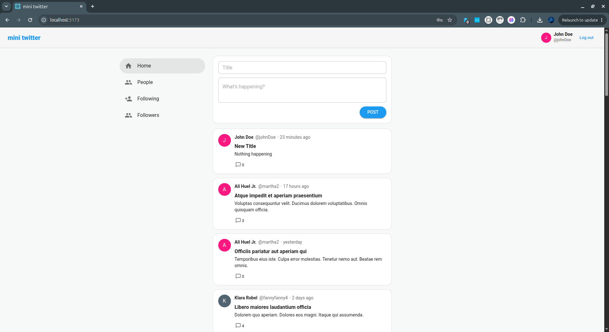
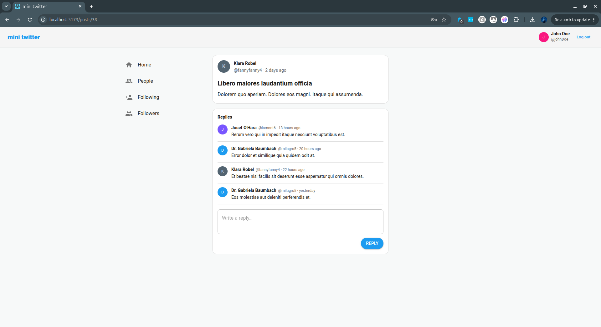
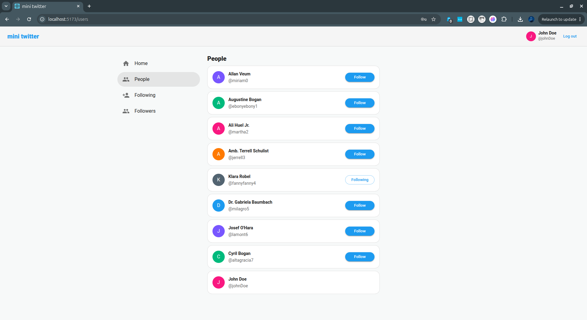
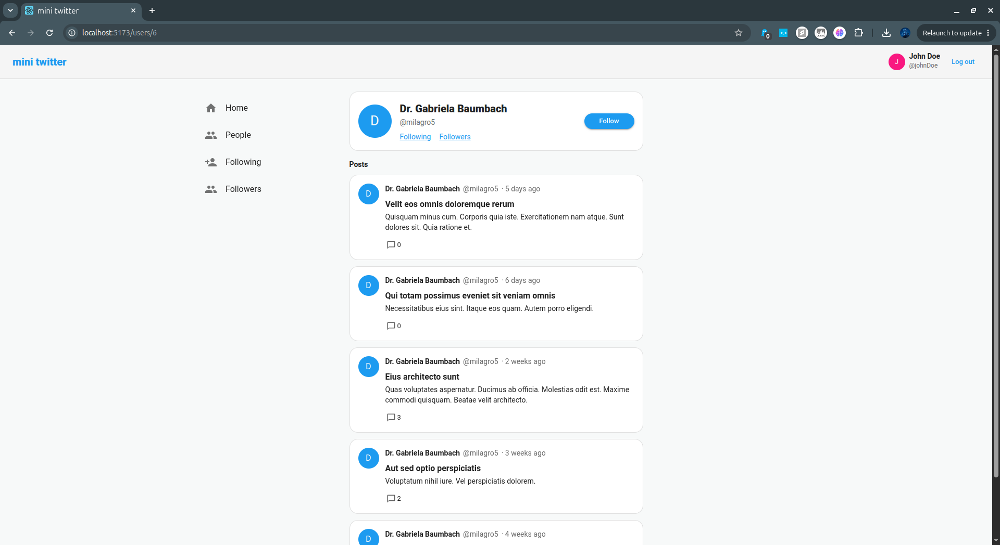
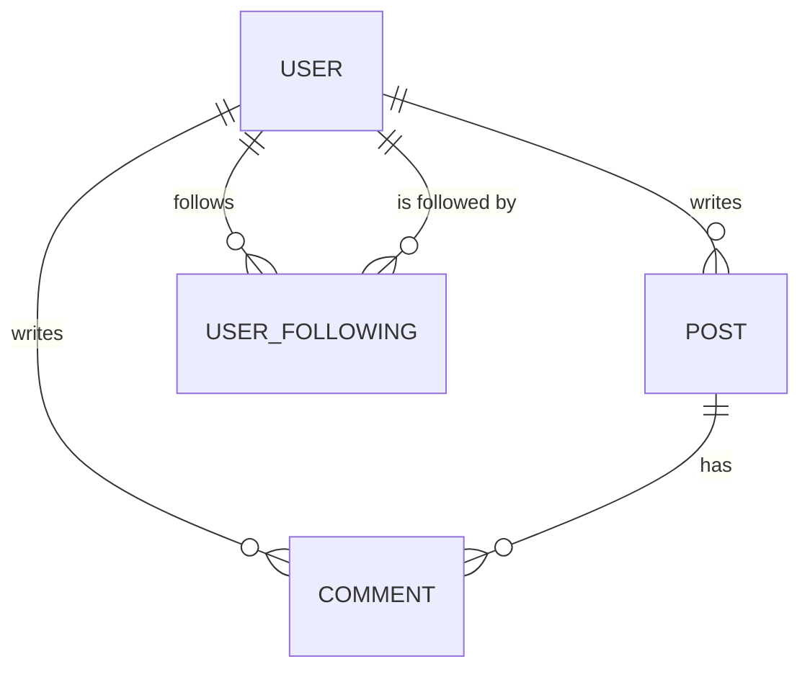

# mini twitter

[](https://github.com/zenith19/mini_twitter/actions/workflows/ci.yml)

A small Twitter-style social app: a **Rails 7.1 JSON API** and a **React 18 single-page client**.
Users sign up, post, reply, and follow each other.

```
mini_twitter/
├── api/   Rails 7.1 API-only backend (Ruby 3.2, PostgreSQL)
└── web/   React 18 SPA (Vite, MUI)
```

## Quick start

```bash
docker compose up --build          # postgres + api + web
docker compose run --rm api bin/rails db:prepare db:seed
```

- Web: <http://localhost:5173>
- API: <http://localhost:3001>
- Seeded logins: `user1@example.com` … `user8@example.com`, password `password123`

<details>
<summary>Running without Docker</summary>

Requires Ruby 3.2.3, Node 20+, and a local PostgreSQL.

```bash
cd api && cp .env.example .env && bin/setup && bin/rails server -p 3001
cd web && cp .env.example .env && npm install && npm run dev
```
</details>

## Screenshots

| | |
|---|---|
|  |  |
| The feed, with the composer | A post and its replies |
|  |  |
| People, showing follow state | A user profile |

## Architecture

```
┌────────────────────┐        Authorization: Bearer <token>        ┌─────────────────────┐
│  React SPA (Vite)  │ ──────────────────────────────────────────► │  Rails API (/v1)    │
│                    │                                             │                     │
│  AuthContext       │  ◄──────────────────────────────────────── │  Authenticatable    │
│  axios client      │        { posts: [...], meta: {...} }        │  AMS serializers    │
└────────────────────┘                                             └──────────┬──────────┘
                                                                              │
                                                                     ┌────────▼────────┐
                                                                     │   PostgreSQL    │
                                                                     └─────────────────┘
```

**Authentication.** `POST /v1/sessions` verifies the password with Devise and issues a random
token. Only a SHA256 digest of that token is stored; the plaintext is returned exactly once and
held by the client in `localStorage`. Protected endpoints read it from a standard
`Authorization: Bearer <token>` header. Logging in rotates the token; logging out clears it.

**Authorization.** Writes are scoped through the current user's associations
(`current_user.posts.find(...)`), so editing or deleting someone else's record returns 404 by
construction rather than relying on a separate ownership check. The author of a post or comment
always comes from the token, never from the request body.

## Data model



`user_followings` has a composite unique index on `(user_id, following_user_id)` and foreign keys
on both columns, so duplicate follows are impossible even under a race.

## API

All responses are JSON, rooted on the resource name, with a `meta` block on collections.

| Method | Path | Auth | Notes |
|---|---|:--:|---|
| `POST` | `/v1/sessions` | | Log in; returns the token |
| `DELETE` | `/v1/sessions` | ● | Log out; revokes the token |
| `POST` | `/v1/users` | | Sign up; returns a token |
| `GET` | `/v1/users` | ○ | Paginated; emails are never public |
| `GET` | `/v1/users/:id` | ○ | |
| `GET` | `/v1/users/:id/posts` | | |
| `GET` | `/v1/users/:id/followings` | ○ | |
| `GET` | `/v1/users/:id/followers` | ○ | |
| `GET` | `/v1/timeline` | ● | Home feed: posts by people you follow, plus your own |
| `GET` | `/v1/posts` | | The public "everything" list, newest first |
| `GET` | `/v1/posts/:id` | | |
| `POST` | `/v1/posts` | ● | Author taken from the token |
| `PATCH` | `/v1/posts/:id` | ● | Owner only |
| `DELETE` | `/v1/posts/:id` | ● | Owner only |
| `GET` | `/v1/posts/:id/comments` | | Paginated |
| `POST` | `/v1/comments` | ● | |
| `PATCH`/`DELETE` | `/v1/comments/:id` | ● | Owner only |
| `POST` | `/v1/follows` | ● | `{ following_user_id }` |
| `DELETE` | `/v1/follows/:id` | ● | `:id` is the user being unfollowed |

● required ○ optional (changes what is rendered)

```bash
TOKEN=$(curl -s -X POST localhost:3001/v1/sessions \
  -H 'Content-Type: application/json' \
  -d '{"email":"user1@example.com","password":"password123"}' | jq -r .authentication_token)

curl -s localhost:3001/v1/posts -H "Authorization: Bearer $TOKEN" | jq '.posts[0]'
```

Collections accept `?page=` and `?per_page=` (default 25, max 100).

## Tests

```bash
make test                                   # both suites
docker compose run --rm -e RAILS_ENV=test api bin/rails test   # 79 runs
cd web && npm test                                              # 38 tests
```

The backend suite covers the auth concern (missing / malformed / unknown / revoked tokens),
cross-user ownership, the follow cycle including duplicate and self-follows, and email privacy.
The frontend suite covers the login flow, the auth-dependent chrome, small-screen navigation, the
follow button, the fetch hook, the feed's two tabs, session expiry, and the owner-only edit and
delete controls.

## Security notes

- Tokens are stored hashed and rotated on every login.
- CORS reads `CORS_ORIGINS`; it is not a wildcard.
- `rack-attack` throttles login (10/min per IP, 5 per 5 min per email), signup, and general traffic.
- No credentials in the repo; `api/config/database.yml` reads the environment.

## Known trade-offs

- `active_model_serializers` 0.10 works on Rails 7.1 but is effectively unmaintained. Replacing it
  with `alba` or `blueprinter` would be the next dependency change.
- `react-router` v6 carries two moderate open-redirect advisories fixed only in v7. This app passes
  no user-controlled input to `<Link>` or `useNavigate`, so it is not reachable here, but the v7
  upgrade is worth doing.
- The token never expires on its own; only login rotation and logout revoke it. The client does
  detect a rejected token and sign out, but a time-to-live on the server would be better.
- Pagination is offset-based, which drifts on a fast-moving feed. Cursor pagination would be the
  fix if the feed ever got busy.

## History

This started as a 2020 learning project in two repositories, built on Rails 6 / Ruby 2.7 and
Create React App. Neither half would start on a current machine. See `git log` for what changed and
why — the commit messages record each original bug alongside its fix.
