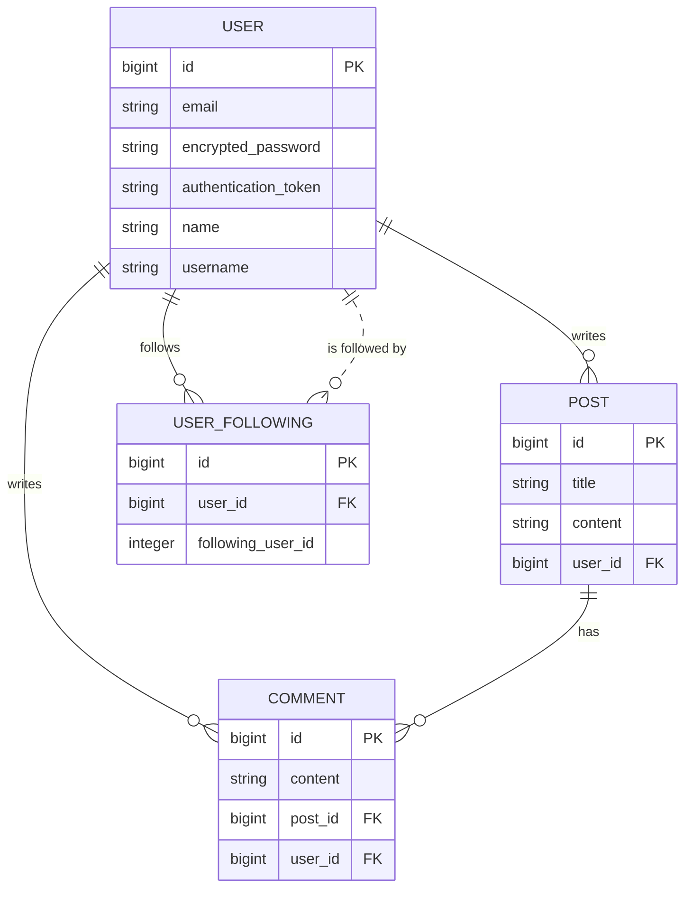

# mini_twitter

A Twitter-style REST API built with **Ruby on Rails 6** in API-only mode. It powers a small social app: users can register, log in, post, comment, and follow each other. Authentication is token-based (Devise + `simple_token_authentication`), and responses are serialized with Active Model Serializers.

This is the backend half of a full-stack learning project — the React frontend lives in [mini_twitter_react](https://github.com/zenith19/mini_twitter_react).

## Stack

- **Ruby** 2.7.1, **Rails** 6.0.3 (API-only)
- **PostgreSQL** (Active Record)
- **Devise** + **simple_token_authentication** for auth
- **Active Model Serializers** for JSON responses
- **Puma** app server, **rack-cors** for cross-origin requests
- Versioned API under the `/v1` namespace, JSON by default
- Dev tooling: **Faker** (seed data), **byebug** (debugging), **Spring** (preloader)

## Data model



| Model | Key fields | Associations |
|-------|-----------|--------------|
| `User` | `email`, `encrypted_password`, `authentication_token`, `name`, `username` | has_many posts, comments |
| `Post` | `title`, `content`, `user_id` | belongs_to user |
| `Comment` | `content`, `post_id`, `user_id` | belongs_to post, user |
| `UserFollowing` | `user_id`, `following_user_id` | join row linking a user to someone they follow |

> Note: `following_user_id` is a plain integer (only `user_id` has a foreign key), which is why the "is followed by" relationship is drawn as a dotted line.

## Authentication

`POST /v1/sessions` with an email and password returns the user's `authentication_token`. Protected endpoints expect that token in a `token` request header. `DELETE /v1/sessions/:id` clears the token (logout).

```bash
# 1. Log in to get a token
curl -X POST http://localhost:3001/v1/sessions \
  -H "Content-Type: application/json" \
  -d '{"email": "alice@example.com", "password": "password"}'
# => {"id":1,"email":"alice@example.com","authentication_token":"abc123..."}

# 2. Send the token in the `token` header on protected requests
curl -X POST http://localhost:3001/v1/posts \
  -H "Content-Type: application/json" \
  -H "token: abc123..." \
  -d '{"title": "Hello", "content": "My first post", "user_id": 1}'
```

## API endpoints

### Users
| Method | Path | Notes |
|--------|------|-------|
| `POST` | `/v1/users` | Register a new user |
| `GET` | `/v1/users` | List users |
| `GET` | `/v1/users/:id` | Show a user |
| `GET` | `/v1/users/:user_id/posts` | Posts by a user |

### Sessions
| Method | Path | Notes |
|--------|------|-------|
| `POST` | `/v1/sessions` | Log in, returns auth token |
| `DELETE` | `/v1/sessions/:id` | Log out *(auth)* |

### Posts
| Method | Path | Notes |
|--------|------|-------|
| `GET` | `/v1/posts` | List all posts |
| `GET` | `/v1/posts/:id` | Show a post |
| `POST` | `/v1/posts` | Create a post *(auth)* |
| `PUT/PATCH` | `/v1/posts/:id` | Update a post *(auth)* |
| `DELETE` | `/v1/posts/:id` | Delete a post *(auth)* |

### Comments
| Method | Path | Notes |
|--------|------|-------|
| `GET` | `/v1/posts/:post_id/comments` | Comments on a post |
| `POST` | `/v1/comments` | Create a comment *(auth)* |

### Following
| Method | Path | Notes |
|--------|------|-------|
| `GET` | `/v1/user_followings/:id` | Users a given user follows |
| `POST` | `/v1/user_followings` | Follow a user *(auth)* |
| `DELETE` | `/v1/user_followings/:id` | Unfollow a user *(auth)* |
| `GET` | `/v1/user_followers/:id` | A user's followers *(auth)* |

## Getting started

```bash
# Prerequisites: Ruby 2.7.1, PostgreSQL running locally

bundle install

# Edit config/database.yml to match your local Postgres credentials
# (it currently hard-codes username: root / password: 1234)

rails db:create db:migrate
rails db:seed        # optional: seeds 5 users, posts, comments, and a follow graph

# The React frontend expects the API on port 3001
rails server -p 3001
```

Seeded users all use the password `12345678` — grab an email from `GET /v1/users` to log in.

## Notes

Built as a learning project to practice designing a versioned REST API with token auth on Rails. A few honest caveats:

- CORS is open to all origins (`origins '*'`) for local development — tighten before any real deployment.
- The token-auth flow is hand-rolled on top of `simple_token_authentication` rather than a standard scheme like JWT.
- Test files are scaffolded but not yet implemented.

**Possible improvements**

- Move DB credentials and config to environment variables / Rails credentials instead of hard-coding them.
- Replace the hand-rolled token flow with a standard scheme (e.g. JWT) and restrict CORS to known origins.
- Fill in the test scaffolds with model and request specs.
- Add pagination to the `index` endpoints (they currently return all records).
- Add model validations and a uniqueness constraint on `user_followings` to prevent duplicate follows.
